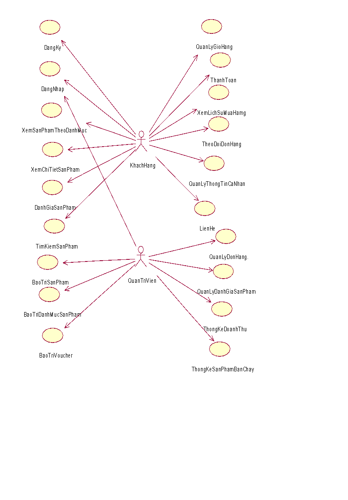
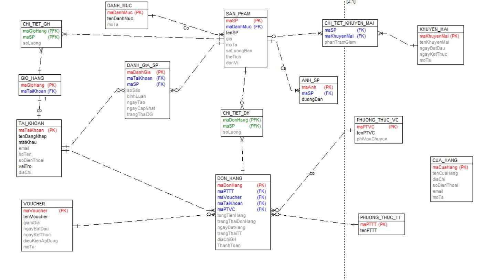

# Tài liệu – NutriMilk

| File | Nội dung |
|---|---|
| [BaoCao_DoAn_NutriMilk.pdf](BaoCao_DoAn_NutriMilk.pdf) | Báo cáo đồ án chuyên ngành: khảo sát, phân tích, thiết kế, cài đặt, kiểm thử |
| [diagrams/use-case-tong-quat.png](diagrams/use-case-tong-quat.png) | Biểu đồ use case tổng quát |
| [diagrams/use-case-phan-ra.png](diagrams/use-case-phan-ra.png) | Biểu đồ use case phân rã |
| [diagrams/erd.png](diagrams/erd.png) | Biểu đồ thực thể liên kết (15 bảng) |

## Nội dung báo cáo

1. **Khảo sát hệ thống:** hoạt động bán hàng, yêu cầu chức năng và phi chức năng.
2. **Phân tích hệ thống:** biểu đồ use case, đặc tả 21 use case, biểu đồ trình tự và biểu đồ lớp phân tích cho 10 use case chính, thiết kế cơ sở dữ liệu.
3. **Thiết kế, cài đặt:** wireframe và biểu đồ lớp màn hình cho 10 chức năng, lựa chọn công nghệ.
4. **Kiểm thử:** kế hoạch kiểm thử, 42 test case, báo cáo kết quả (xem thêm thư mục [test](../test)).

## Biểu đồ use case tổng quát

## Biểu đồ thực thể liên kết

